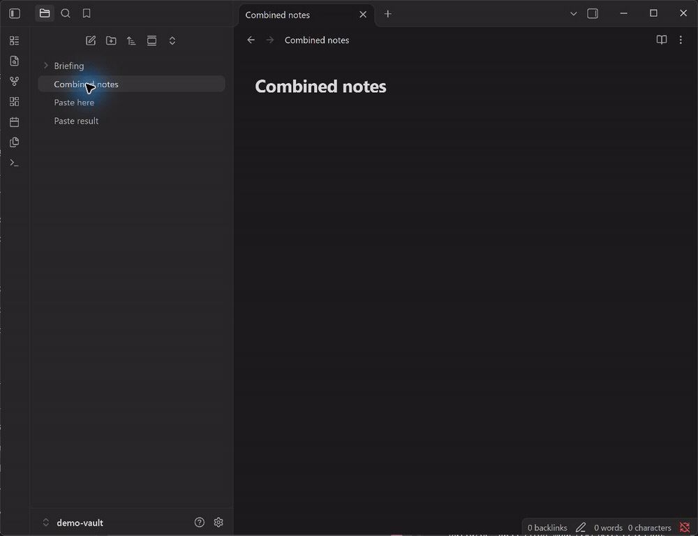

# Copy Contents

Copy or export the contents of an Obsidian file or folder in Markdown, plain text, or JSON format.



Right-click a folder, choose the files to copy, then paste the combined notes. This six-second demonstration uses synthetic notes; file selection is enabled with a threshold of two files.

## Features

- Copy a file or an entire folder from the file menu.
- Export the same content to a file inside the vault.
- Keep nested folder paths when combining files.
- Select which files to include in larger folders.
- Filter by extension and maximum file size.
- Use Markdown, plain text, or structured JSON output.
- Run every action from the command palette and assign your own hotkeys.

Copy Contents works locally inside Obsidian. It does not send notes, usage data, or credentials over the network.

## Privacy and clipboard access

Copy Contents accesses the system clipboard only when you explicitly choose a
**Copy Contents** action. It writes the selected note content to the clipboard;
it never reads existing clipboard content. The plugin has no network requests,
analytics, or background clipboard monitoring.

Clipboard contents may be visible to your operating system's clipboard history
and to other applications. Use an **Export Contents** action instead when you do
not want note content placed on the clipboard.

## Usage

Right-click a file or folder and choose a **Copy Contents** action. You can also open the command palette with `Ctrl+P` or `Cmd+P` and search for:

- Copy active file contents to clipboard
- Copy current folder contents to clipboard
- Export active file contents to file
- Export current folder contents to file

When file selection is enabled and the number of eligible files reaches the configured threshold, the plugin opens a dialog before reading their contents. Choose the files you want, then select **Copy selected** or **Export selected**.

## Settings

After enabling the plugin, open **Settings** and select **Copy Contents** under Community plugins to configure:

- Output format
- File names and folder headings
- Separator between files
- Supported extensions and maximum file size
- File-selection threshold
- Export folder and timestamped file names

## Installation

### Community Plugins

Copy Contents is listed in the Obsidian community directory:

1. Open **Settings → Community plugins → Browse**.
2. Search for **Copy Contents**.
3. Select **Install**, then **Enable**.

### Manual installation

1. Download `main.js`, `manifest.json`, and `styles.css` from the latest GitHub release.
2. Put them in `<vault>/.obsidian/plugins/copy-contents/`.
3. Reload Obsidian and enable **Copy Contents** under Community plugins.

## Development

This project requires Node.js 20 or later.

```sh
npm ci
npm run setup
npm run dev
```

Run all release checks with:

```sh
npm run validate
```

The version in `package.json`, `manifest.json`, and `versions.json` must match. Creating a Git tag runs the release workflow and prepares a draft GitHub release with the required Obsidian assets.

Contributor guidance and the project's local-first security boundaries are documented in [CONTRIBUTING.md](CONTRIBUTING.md) and [SECURITY.md](SECURITY.md).

## Support

Use [GitHub Issues](https://github.com/Accsimplify/obsidian-copy-contents/issues) for bugs and feature requests.

## License

[MIT](LICENSE)
